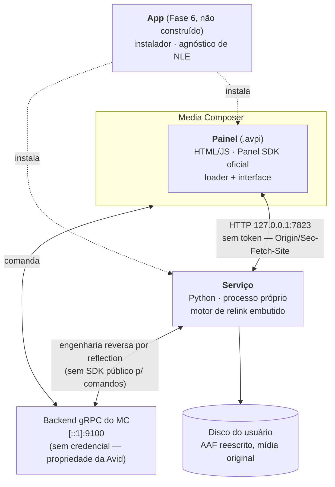

# Arquitetura do De Lá Pra Cá

Documento de visão geral: o que o De Lá Pra Cá é, de que partes ele é feito, como essas
partes conversam, onde ele escreve no disco e o que sai (ou não sai) da máquina.

Escrito para quem chega de fora — alguém que vai contribuir, revisar ou avaliar o
plugin sem ter acompanhado o desenvolvimento. As decisões que explicam **por que** cada
coisa é como é ficam nos [ADRs](adr/), referenciados ao longo do texto.

Versão descrita: **0.1.7**. O que estiver aqui vale para o código na `main`; se algo
divergir, o código é a verdade.

---

## 1. O que o De Lá Pra Cá é

Um **plugin do Avid Media Composer** que relinka a timeline de um editor online — que
chegou por AAF, com mídia offline — para a mídia original no disco, sem sair do editor
e sem quebrar efeitos. O editor abre o painel (**Tools → De Lá Pra Cá**), aponta a pasta
das mídias originais, revisa os casamentos sugeridos e aplica: o Media Composer religa
os masters, e a timeline volta a ficar online com Titler+, timewarp, estabilizadores e
demais efeitos intactos.

Três características definem a forma do software:

- **É local.** Sem servidor remoto, conta de usuário, nuvem ou telemetria. A mídia e os
  metadados de produção nunca saem da máquina do editor.
- **Roda DENTRO do Media Composer.** Não é um app externo que imita o editor — pede ao
  próprio Avid que monte a timeline, por isso os efeitos sobrevivem por construção
  ([ADR 0001](adr/0001-plugin-autonomo-dentro-do-editor.md)).
- **Roda nos dois sistemas.** O **Windows é a plataforma principal de instalação**; o
  macOS é onde nasceu e continua funcionando. Toda diferença mora num módulo só,
  `servico/plataforma.py`
  ([ADR 0011](adr/0011-uma-camada-de-plataforma-e-degradacao-por-versao.md)).

---

## 2. Visão geral

Duas conversas, em direções opostas — a mesma que o docstring de `main.py` desenha:



Cada peça tem um papel único:

| Camada | Tecnologia | Responsabilidade | Não faz |
|---|---|---|---|
| Painel | HTML/JS, Panel SDK oficial da Avid | Loader + interface dentro do MC; dirige o serviço por HTTP | Nenhuma lógica de relink, não acessa disco |
| Serviço | Python 3.11+ | HTTP local, sessão de trabalho, cliente gRPC do MC, motor embutido | Não desenha nada |
| Plataforma (`servico/plataforma.py`) | Python + `ctypes` | O **único** lugar que sabe em qual SO está: pastas, processos, órfão do gateway, coluna `Drive`, abrir URL | Não conhece HTTP nem o motor |
| Motor (`motor/`) | Python (parser AAF, matcher, writers) | Ler/reescrever AAF, indexar mídia, casar nomes, achatar timeline | Não conhece HTTP nem Panel SDK |
| App (planejado) | — (Fase 6) | Instalar painel+serviço; atender quem não tem o MC aberto | Ainda não existe código |

**Por que painel e serviço são processos separados:** o Panel SDK só executa HTML/JS
dentro da webview do MC — sem acesso a disco, sem `subprocess`, sem gRPC. O motor
(parser AAF, protobuf) precisa de um processo Python de verdade ao lado. HTTP é o
denominador comum entre os dois, do mesmo jeito que o Órbita resolve o problema
equivalente para Premiere/Resolve (ver ADR 0010 do repositório irmão).

---

## 3. As duas conversas

### 3.1 Painel ↔ Serviço — HTTP em `127.0.0.1:7823`

Rotas (`plugins/media-composer/servico/api/rotas.py`): `/health`, `/static/painel.js`,
`/static/painel.css`, `/mc/info`, `/mc/sequences`, `/mc/mob`, `/mc/preset`,
`/mc/preset/instalar`, `/link/abrir`, `/escolher/pasta`, `/escolher/timeline`,
`/trabalho`, `/trabalho/masters`, `/trabalho/preparar`, `/trabalho/escolher`,
`/trabalho/opcoes`, `/trabalho/aplicar`, `/trabalho/cancelar`, `/progresso` (SSE).

Ao contrário do Órbita, **não há token de arquivo**: o servidor é do próprio plugin, sem
segundo cliente externo a distinguir. A defesa é `Origin`/`Sec-Fetch-Site` — os dois são
*forbidden headers*, nenhuma página web consegue defini-los. O raciocínio completo
(incluindo o que essa defesa explicitamente não cobre) está no
[ADR 0007](adr/0007-portao-sem-token-defesa-por-origem.md).

`avid-manifest.json` reforça o mesmo limite do lado do painel: `allowedDomains` só
permite `localhost:7823`/`127.0.0.1:7823` — o plugin não alcança nenhum outro endereço.

`/health` bate a cada 4 s, mas **não fala com o Media Composer** — o estado do MC é
consultado sob demanda em `/mc/info`, porque toda chamada gRPC tem piso de ~500 ms e uma
batida de 4 em 4 segundos gastando meio segundo do laço do MC seria um imposto
permanente sobre o editor.

### 3.2 Serviço ↔ Media Composer — gRPC em `[::1]:9100`

O serviço fala com o backend interno do Media Composer por gRPC *insecure*
(`avid/mcapi.py`). **Não existe SDK público para o canal de comando** (`LinkFile`,
`ImportFile`, `GetBins`, `CreateBin`...) — o `.proto` veio do banco de NLEs, extraído por
reflection do próprio Media Composer, do mesmo jeito que o Órbita faz para os NLEs que
não têm SDK de automação. O que É SDK oficial da Avid é só a casca do plugin: o **Panel
SDK** (`.avpi`, `avid-manifest.json`, `uiItems`, `windowSize` — mecanismo documentado de
registro de painéis).

O backend `[::1]:9100` **não pede credencial nenhuma** — qualquer processo local comanda
o Media Composer inteiro. É propriedade do produto da Avid, não escolha deste projeto
(ver [ADR 0007](adr/0007-portao-sem-token-defesa-por-origem.md)).

Cada operação abre e fecha o **seu próprio** canal gRPC — nunca um canal guardado entre
chamadas, porque o editor abre e fecha o Media Composer enquanto o painel segue aberto
([ADR 0010](adr/0010-um-canal-grpc-por-operacao.md)).

⚠️ **`[::1]` é literal, e `localhost` não aparece em lugar nenhum.** No Windows o nome
resolve para IPv6 ao escutar e IPv4 ao discar, e a máquina *descarta* o pacote em vez de
recusá-lo: paga-se **timeout** antes do fallback. Medido no app irmão, mesma URL e cache
quente: `[::1]` 0,012–0,18 s · `127.0.0.1` 2,03 s fixos · `localhost` 2,98 → 15,7 s,
piorando. No macOS o IPv4 é recusado na hora e o problema é invisível — é um bug que
**não existe** na máquina de quem desenvolveu.

### 3.3 ⭐ Uma terceira conversa: o ARRASTO, que não passa por nenhuma das duas

O editor arrasta a timeline da bin **para dentro do painel**, e o Media Composer entrega
o payload à webview como um **MIME customizado** — `text/x.avid.mc-api-asset-list+json`,
lido por um `ondrop` de DOM comum. **Não é rpc, não é evento, e nada é declarado no
manifesto**: a capacidade não é concedida, ela existe para qualquer painel que escute
`drop`.

O payload é um array JSON com `id` (MobID), `type` (`sequence`/`masterclip`/`subclip`) e
`in`/`out`. Só falta o **nome**, que a rota `/mc/mob` busca com uma chamada.

É o caminho mais barato que existe para dizer "é esta timeline": zero chamadas contra as
~500 ms × nº de bins de `/mc/sequences` — e funciona com a bin fechada, que o seletor
não alcança ([ADR 0012](adr/0012-a-timeline-entra-por-arrasto.md)).

⚠️ **Descoberto lendo um produto de terceiro** (painel do ESION Studio), não em
documentação: não há contrato público, e por isso o seletor de sequences continua
existindo e a falha do drop é **falante** — se o MIME não vier, o painel mostra os tipos
que chegaram.

### 3.4 A versão do Media Composer não é nossa

O SDK é fechado e o editor atualiza quando quer. `GetListOfWindows` responde no MC 25.12
e devolve `UNIMPLEMENTED` no 25.6 — e é a única forma conhecida de saber quais bins estão
abertas. Por isso todo rpc de *conveniência* tem um caminho sem ele, e a ausência tem
exceção própria (`McApiNaoImplementado`), separada de "a chamada falhou".

⭐ A degradação é de **três estados**: `bins_abertas()` devolve `None` para *"não dá para
saber"*, que não é `[]` (*"nenhuma aberta"*). Confundir os dois inverteria o resultado —
a seleção voltaria vazia com o editor tendo marcado tudo
([ADR 0011](adr/0011-uma-camada-de-plataforma-e-degradacao-por-versao.md)).

---

## 4. O motor de relink

Vive em `motor/aaf/` (parser, percurso, matcher de masters, remap, writer),
`motor/media/` (indexação de mídia, matcher de nomes, `safepath`), e mais dormentes:
`motor/frames/` (pHash, não usado no plugin — [ADR 0004](adr/0004-sem-matcher-visual-confirmacao-humana.md)),
`motor/avb_export/` (rota `.avb`, backend do App agnóstico — [ADR 0001](adr/0001-plugin-autonomo-dentro-do-editor.md)),
`motor/drp/` e `motor/otio_export/` (writers para Resolve, ainda dormentes).

### 4.1 Duas rotas, um só matcher

⭐ A metade de **casamento** é a mesma nas duas rotas: `casar_masters` consome objetos
`Master` (`nome`, `mob_id`, `segmentos`, `duracao_frames`, `edit_rate`) e **nada nele é de
AAF**. O que muda é o **leitor** — e, na aplicação, o veículo de volta:

| | rota AAF (padrão) | rota `.avb` ([ADR 0013](adr/0013-a-rota-avb-volta-a-existir.md)) |
|---|---|---|
| leitor | `motor/aaf/masters.py` | `motor/avb_bin/masters.py` |
| como a timeline chega | `ExportFile` + **preset** | lida da própria bin |
| como volta | `ImportFile` | a bin é editada e aberta |
| áudio | `LinkFile` (abre modal por WAV) | masters **autorados** (sem modal) |

### 4.2 O caminho que o motor resolve

```
AAF (timeline offline)  →  índice de masters/segmentos (aaf/percurso.py)
                         →  casar cada master com um arquivo no disco (media/matcher_masters.py)
                         →  achatar subclipes/group clips (aaf/denest.py)
                         →  remapear MobID no AAF (aaf/remap.py)
                         →  AAF reescrito, pronto para LinkFile + ImportFile
```

**Matching é por MASTER, não por segmento** — um master aparece em vários pontos da
timeline; casar uma vez resolve todos ([ADR 0003](adr/0003-matching-por-master-nao-por-segmento.md)).
O casamento decide por **nome exato normalizado**; correspondência frouxa nunca decide
sozinha, só sugere ([ADR 0005](adr/0005-nome-normalizado-decide-frouxo-e-sugestao.md)).

**A fronteira que mais importa dentro do motor** é `aaf/percurso.py`: o único lugar que
sabe descer a estrutura recursiva do AAF (`NestedScope`, `Selector.Alternates`). Três
módulos reimplementaram esse percurso de formas ligeiramente diferentes, e cada cópia
esqueceu um ramo — sempre sem erro, só um número menor do que devia
([ADR 0006](adr/0006-achatar-subclipes-antes-do-importfile.md)).

### 4.2 Entrada não confiável

Todo caminho vindo do painel passa por `media/safepath.py` antes de virar argumento de
ffmpeg/MediaInfo — mesma fronteira e mesmo motivo do Órbita: `pymediainfo` busca URL
quando a string tem `://`, e o ffprobe lê um nome começado em `-` como opção.

---

## 5. O fluxo de uma sessão de trabalho

`sessao.py` embrulha o relink síncrono numa thread e expõe o estado por HTTP. **Uma
sessão por vez** — o Media Composer é recurso único, a segunda preparação recebe `409`.
O progresso (`/progresso`, SSE) entrega o **estado inteiro** a cada evento, não um
delta: se o painel cair no meio de uma aplicação de 80 s, a próxima conexão reencontra a
situação sem depender de nenhum evento específico ter chegado
([ADR 0008](adr/0008-uma-sessao-por-vez-progresso-lido-por-sse.md)).

Sequência típica: `preparar` (índice + matching, ~3 s para ~118 masters) → editor revisa
sugestões e conflitos → `escolher`/`opções` → `aplicar` (achatar → `LinkFile` em massa →
remap → `ImportFile`). Medido em escala real: `LinkFile` é ~92% do tempo de aplicação
(piso de ~500 ms por chamada do MC) — por isso a barra de progresso é requisito, não
enfeite.

O export de AAF direto da timeline do MC (quando o editor não parte de um AAF já em
mãos) usa um preset **embarcado** (`AAF-DLPC`) em vez de confiar no nome de um preset
escolhido pelo editor — um preset chamado "AAF" já se mostrou, medido, um WAVE Export
disfarçado ([ADR 0009](adr/0009-preset-de-export-embarcado.md)).

---

## 6. Ciclo de vida e instalação

Hoje (Fase 6 ainda não construída), a instalação é manual: `tools/pack.py` empacota
`plugins/media-composer/painel/` num `.avpi` e o copia para a pasta de painéis do Panel
SDK — que é **de sistema nos dois SOs** (`/Library/Application Support/Avid/PanelSDKPlugins`
no macOS, `%PROGRAMDATA%\Avid\PanelSDKPlugins` no Windows), ao contrário do Premiere e do
Resolve, que instalam por usuário. Não pediu elevação em nenhuma das duas máquinas.

O **serviço** é iniciado à parte (`dev.sh` / `dev.ps1`, que rodam
`plugins/media-composer/servico/main.py`). Não há autostart do serviço nem instalador
único — ver [Limites conhecidos](#11-limites-conhecidos).

Uma vez instalados, painel e serviço são **autônomos**: não dependem de um App De Lá Pra
Cá aberto ([ADR 0001](adr/0001-plugin-autonomo-dentro-do-editor.md)). O App, quando
existir, é só o instalador — e a porta de entrada para quem não tem o Media Composer
aberto (via `avb_export`, a rota que reautora a timeline em vez de pedir ao MC).

`tools/reload.py` existe por um motivo medido: o `avid-api-gateway` não morre sozinho com
o Media Composer — vira órfão e segura as portas 4920/4930. No boot seguinte o menu dos
painéis simplesmente não é criado, sem erro e sem log visível. ⭐ **A assinatura do órfão
muda de SO**: no macOS o `launchd` o adota (`ppid == 1`); o Windows não reparenta, então
o órfão é aquele cujo `ppid` já não aponta para ninguém vivo — e como o Windows recicla
PID, a checagem tem de ser refeita, não decidida uma vez.

---

## 7. O que o serviço escreve no disco

| O quê | Onde (macOS) | Onde (Windows) |
|---|---|---|
| AAF reescrito (remapeado, achatado) | `~/Library/Application Support/DeLaPraCa/trabalho/` | `%LOCALAPPDATA%\DeLaPraCa\trabalho\` |
| Preset de export embarcado | `/Users/Shared/AvidMediaComposer/Avid Users/<u>/<u> Settings.xml` | `C:\Users\Public\Documents\Avid Media Composer\Avid Users\<u>\<u> Settings.xml` |
| Logs | saída padrão do processo (`--log debug/info`), sem arquivo dedicado ainda | idem |

⚠️ A pasta de trabalho **não** é temporária, e isso é requisito: quem lê o AAF reescrito
é o processo do *Media Composer*, e no macOS o TCC o impede de ler `/private/tmp`.

**A mídia original nunca é modificada.** O serviço lê os arquivos do acervo e escreve
só o AAF de trabalho que o próprio `LinkFile`/`ImportFile` vai consumir.

---

## 8. O que sai da máquina

**Nada.** Sem telemetria, sem analytics, sem conta, sem chamada de rede externa. Toda
comunicação é loopback: HTTP em `127.0.0.1:7823` (painel ↔ serviço) e gRPC em
`[::1]:9100` (serviço ↔ Media Composer). `avid-manifest.json` restringe o painel a esses
dois endereços por `allowedDomains` — não há como o plugin alcançar a internet mesmo se
quisesse.

---

## 9. Sanitização e distribuição

O projeto ainda não foi publicado (sem remote configurado). Segue o mesmo modelo do
Órbita, adaptado:

- **`.dev/`** (gitignorado, fora do controle de versão) guarda `DECISIONS.md` — o log
  cronológico de decisões, que cita nome de projeto/cliente real e caminhos de disco —
  e os scripts de bancada que dependem de mídia real (`spike_rota_aaf.py`,
  `e2e_relink.py`). Os ADRs deste documento são a versão pública e generalizada dessas
  decisões, sem informação de cliente.
- **`publish.py`** gera o artefato público por allowlist (`motor`, `plugins`, `tests`,
  `tools`, `README.md`, `VENDOR.md`, `VERSION`, `dev.sh`, `requirements.txt`), com gate
  obrigatório de `gitleaks`. Ainda não há repo público de destino — o workflow
  (`.github/workflows/publish.yml`) está pronto, mas com placeholder até esse repo
  existir.

---

## 10. Testes

| Suíte | Onde | O que cobre |
|---|---|---|
| Regressão | `tests/test_*.py` | Portão HTTP (22), fronteira de arquivo (14), nomes (39), plataforma (21), preset de export (15), progresso (20), rota `.avb` (29) — **160 casos, verdes no Windows e sem precisar do MC aberto** |
| Scripts de bancada | `.dev/spike_rota_aaf.py`, `.dev/e2e_relink.py` | Relink contra mídia real e Media Composer aberto — não portáveis, não rodam em CI |

`publish.py` roda a suíte de regressão contra o artefato público gerado, provando que
ele é instalável e testável sozinho.

---

## 11. Limites conhecidos

- **Fase 6 (App instalador) não existe** — instalação e start do serviço são manuais
  hoje (`tools/pack.py` + `dev.sh`/`dev.ps1`).
- **No MC 25.6 o painel abre mais devagar.** Sem `GetListOfWindows`, `/mc/sequences`
  pergunta a todas as bins do projeto (~500 ms cada) e a timeline não vem pré-selecionada.
- **`path_to_aaf_url` no Windows é `pendente`** — usamos `Path.as_uri()`, a forma
  canônica, **não medida** contra um AAF exportado pelo próprio MC no Windows. No macOS
  a forma canônica também parecia certa e estava errada, e o modo de falha é o mesmo:
  mídia offline em silêncio. Não afeta o relink (lá quem AMA-linka é o `LinkFile`).
- **Módulos dormentes com I/O de texto sem `encoding=`** (`motor/frames/cache.py`,
  `motor/avb_export/`) — no Windows isso vira cp1252 e quebra num caminho acentuado.
  Fora do caminho do relink, mas é dívida conhecida.
- **Caminho de *group clip* do achatamento não foi exercitado** — o material de teste
  não tem multicam ([ADR 0006](adr/0006-achatar-subclipes-antes-do-importfile.md)).
- **Dois `uiItems` no manifesto (janela de revisão larga) é experimental.** O schema do
  Panel SDK permite múltiplos itens, mas nenhuma amostra conhecida (Jumper, Quickture,
  Órbita) usa mais de um — se o Media Composer aceita os dois de fato ainda não foi
  confirmado.
- **Sem autostart do serviço.** O Órbita também não tem; um plugin que se quer autônomo
  precisa de uma resposta própria para isso.
- **Adaptador para outros NLEs não existe.** O motor é agnóstico de NLE
  ([ADR 0001](adr/0001-plugin-autonomo-dentro-do-editor.md)), mas hoje só o Media
  Composer tem painel+serviço construídos.

---

## 12. Mapa do repositório

```
motor/                    Motor de relink (agnóstico de NLE)
  aaf/                    Parser, percurso, matcher de masters, remap, writer AAF
  avb_bin/                Rota .avb: ler/achatar/repontar a bin do editor (ADR 0013)
                          ⚠️ NÃO pode se chamar `avb` — é o nome do pyavb, e o sombrearia
  media/                  Indexação, matcher de nomes, safepath
  avb_export/             Rota .avb (dormente aqui, backend do App agnóstico)
  frames/                 pHash (dormente, não usado no plugin — ADR 0004)
  drp/, otio_export/      Writers para Resolve (dormentes)
plugins/media-composer/
  painel/                 O .avpi: manifesto + loader (Panel SDK oficial)
  servico/                Processo Python: HTTP local, sessão, cliente gRPC
    plataforma.py         O ÚNICO lugar que sabe qual é o SO (ADR 0011)
    relink.py             Rota AAF (padrão) + a metade de leitura/casamento
    relink_avb.py         Rota .avb: edita a bin do editor (ADR 0013)
    api/                  Rotas HTTP e o portão (Origin/Sec-Fetch-Site)
    avid/                 Cliente gRPC do MC (mcapi.py) + .proto por reflection
tests/                    Suíte de regressão (portão, arquivos, nomes, plataforma)
tools/                    pack.py (empacota+instala), reload.py, gen_mcapi_stubs.py
                          (pack.sh/reload.sh são atalhos — uma implementação só)
dev.sh · dev.ps1          Modo desenvolvedor, um por sistema operacional
docs/adr/                 Decisões de arquitetura
.dev/                     Privado — DECISIONS.md e scripts de bancada (gitignorado)
```

---

## 13. Índice dos ADRs

| # | Assunto |
|---|---|
| [0001](adr/0001-plugin-autonomo-dentro-do-editor.md) | O plugin roda dentro do Media Composer; o App é só o instalador |
| [0002](adr/0002-relink-por-aaf-via-linkfile.md) | Relink por AAF via `LinkFile`, não reautoria por `.avb` |
| [0003](adr/0003-matching-por-master-nao-por-segmento.md) | Matching por MASTER, não por segmento |
| [0004](adr/0004-sem-matcher-visual-confirmacao-humana.md) | Sem matcher visual no plugin; a confirmação é humana |
| [0005](adr/0005-nome-normalizado-decide-frouxo-e-sugestao.md) | Nome exato normalizado decide; frouxo é sempre sugestão |
| [0006](adr/0006-achatar-subclipes-antes-do-importfile.md) | Achatar subclipes e group clips antes do `ImportFile` |
| [0007](adr/0007-portao-sem-token-defesa-por-origem.md) | O portão não usa token de arquivo; a defesa é `Origin`/`Sec-Fetch-Site` |
| [0008](adr/0008-uma-sessao-por-vez-progresso-lido-por-sse.md) | Uma sessão por vez; progresso é lido, não empurrado |
| [0009](adr/0009-preset-de-export-embarcado.md) | O preset de export AAF vem embarcado |
| [0010](adr/0010-um-canal-grpc-por-operacao.md) | Um canal gRPC por operação, nunca guardado |
| [0011](adr/0011-uma-camada-de-plataforma-e-degradacao-por-versao.md) | Uma camada de plataforma, e degradação explícita por versão do MC |
| [0012](adr/0012-a-timeline-entra-por-arrasto.md) | A timeline entra por arrasto; o seletor de sequences vira o plano B |
| [0013](adr/0013-a-rota-avb-volta-a-existir.md) | A rota `.avb` volta a existir: relink pela bin, sem AAF (emenda o 0002) |
